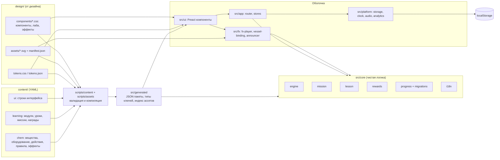
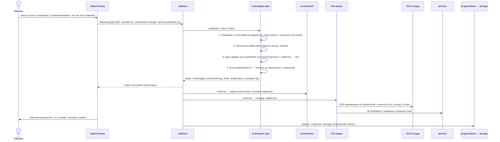
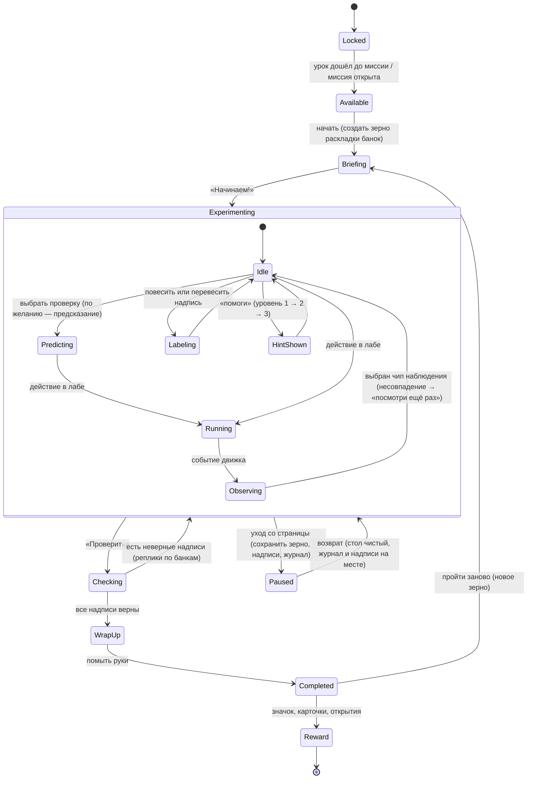

# 03. Архитектура

## 1. Принципы

1. **Контент — данные, движок — код.** Вещества, правила, эффекты, уроки, миссии, тесты, награды и все тексты лежат в `content/` и проверяются схемой. Код только читает и применяет их.
2. **Чистое ядро, тонкая оболочка.** Вся логика (движок реакций, миссии, логика уроков, прогресс) — чистые функции на TypeScript без DOM, времени и случайности. Интерфейс только показывает состояние и передаёт действия в ядро.
3. **Явность важнее краткости.** Код пишет ИИ-агент, ревьюит человек. Поэтому выбираем решения, которые легко прочитать: явные типы, явные переходы состояний, мало «магии» фреймворков, мало зависимостей.
4. **Проверяемость каждым шагом.** Любое поведение можно проверить таблицей «вход → ожидаемый выход». Сборка падает, если контент или ассеты нарушают контракт.
5. **Дизайн — внешний поставщик с контрактом.** Токены, SVG-ассеты и CSS компонентов приходят из `design/`. Фронтенд их не правит, а использует по описанному контракту (раздел 10).
6. **Ничего лишнего в сети.** Статический сайт без сторонних запросов, без cookie, без бэкенда в MVP.

## 2. Выбор стека

### 2.1. Итог

| Слой | Выбор |
| --- | --- |
| Тип приложения | Статическое одностраничное приложение (SPA), маршруты через `#` |
| Язык | TypeScript в строгом режиме |
| Сборщик и dev-сервер | Vite |
| UI | Preact (компоненты на JSX, хуки) |
| Состояние | Ядро — редьюсеры (чистые функции); в UI — маленькое собственное хранилище с подпиской и селекторами (около 60 строк) |
| Отрисовка лабы | SVG-сцена из ассетов дизайна, состояние сосудов через CSS-переменные; эффекты — CSS-анимации из `design/components/effects.css` и Web Animations API для последовательностей. Canvas — только как запасной путь для частиц, если не уложимся в бюджет |
| Анимации | Без библиотек: CSS + Web Animations API через тонкий помощник `Timeline` |
| Перетаскивание | Собственная реализация на Pointer Events + «тап-тап» + клавиатура |
| Контент | YAML-файлы, схема на Zod, компиляция в JSON на этапе сборки (по одному пакету на язык и модуль) |
| Тесты | Vitest (юнит, табличные тесты движка, контент), Testing Library для Preact (компоненты), Playwright (e2e в Chromium, WebKit, Firefox), axe-core (доступность), Lighthouse CI (производительность) |
| Качество | ESLint (typescript-eslint strict), Prettier, Stylelint, контроль границ модулей (eslint-plugin-boundaries или dependency-cruiser) |
| CI/CD | GitHub Actions; деплой на GitHub Pages; превью PR |
| Node | LTS (в окружении агента сейчас 22.x), версия закреплена в `.nvmrc` |

Точные версии зависимостей фиксируются в задаче M0-01 по последним стабильным релизам и закрепляются в `package-lock.json`. Обновления — через Dependabot отдельными PR.

### 2.2. Сравнение альтернатив

**Тип приложения.**

| Вариант | Плюсы | Минусы | Решение |
| --- | --- | --- | --- |
| SPA, маршруты через `#` | Работает на GitHub Pages без серверных правил; работает в подпапке превью; простая маршрутизация | Адреса с `#` выглядят хуже; SEO хуже | **Выбрано.** SEO для главной и страницы родителей решаем статическими HTML-страницами при сборке (S) |
| SPA с History API | Красивые адреса | Нужен трюк с `404.html` на GitHub Pages; ломается в подпапках превью | Отклонено для MVP; можно перейти позже без изменения ядра |
| Генератор статических страниц (Astro и т. п.) | SEO, частичная гидратация | Лаба — одно большое интерактивное приложение, выгода мала; ещё один инструмент | Отклонено. Astro можно добавить для страниц для взрослых после MVP |

**UI-фреймворк.**

| Вариант | Размер (gzip, порядок) | Плюсы | Минусы для нас |
| --- | --- | --- | --- |
| Без фреймворка (TypeScript + DOM) | 0 | Полная явность, ноль зависимостей | Много ручного кода для уроков, тестов, форм; агент будет изобретать свой мини-фреймворк — хуже для ревью |
| React | ~45–60 КБ | Самый знакомый ИИ-агентам и людям; огромная экосистема | Размер съедает половину бюджета JS (NFR-001) |
| **Preact** | ~5 КБ | API как у React (JSX, хуки) — агент пишет уверенно, ревьюер читает привычный код; маленький размер; Testing Library есть | Экосистема меньше, иногда нужен `preact/compat` |
| Svelte 5 | ~10–20 КБ | Компактный код, встроенные анимации | Две несовместимые версии синтаксиса (до и после «рун») — агент путает; своя система реактивности хуже видна на ревью |
| SolidJS | ~7 КБ | Быстрый, мелкозернистая реактивность | Похож на React, но ведёт себя иначе (компонент выполняется один раз) — источник тонких ошибок у агента и ревьюера |
| Lit (веб-компоненты) | ~6 КБ | Стандарт браузера | Многословно, неудобные тесты, теневой DOM мешает общим стилям дизайна |

**Выбран Preact.** Лабу и уроки удобно описывать компонентами, а большая часть логики всё равно живёт в ядре без фреймворка. Если Preact когда-нибудь станет мешать, переход на React — механическая замена импортов.

**Отрисовка лаборатории.**

| Вариант | Плюсы | Минусы | Решение |
| --- | --- | --- | --- |
| **SVG + CSS-переменные** | Дизайн уже отдаёт SVG со слоями и переменными (`--level`, `--liquid-color`, `--turbidity`…); чёткость на любом экране; доступность (роли, подписи); проверяется в DOM-тестах; анимации на композиторе | Сотни анимированных узлов могут тормозить на слабых планшетах | **Основа.** Лимит частиц (NFR-007), анимация только `transform` и `opacity` |
| Canvas 2D | Тысячи частиц без нагрузки на DOM | Нет доступности и DOM-тестов; нужно перерисовывать ассеты в коде | Запасной путь только для слоя частиц, за флагом, если NFR-005 не выполняется |
| WebGL | Максимальная производительность | Сложность, размер, не нужно для 2D | Отклонено |
| Гибрид SVG + canvas-оверлей | Лучшее из обоих | Две модели отрисовки | Архитектурно заложен (слой эффектов изолирован), включается только по результатам замеров в M6 |

**Анимации.**

| Вариант | Решение |
| --- | --- |
| **CSS-анимации дизайна + Web Animations API** | Выбрано. Ключевые кадры уже есть в `effects.css`; WAAPI даёт промисы окончания и паузу; сниженное движение работает через токены |
| GSAP | Мощный, но крупная зависимость с собственной лицензией; избыточен |
| Motion (Motion One) | Небольшой, но ещё одна модель анимаций поверх готовых ключевых кадров дизайна |

**Управление состоянием.**

| Вариант | Решение |
| --- | --- |
| **Редьюсеры ядра + собственное хранилище с селекторами** | Выбрано. Состояние лабы — результат чистой функции движка, поэтому внешнее хранилище только держит текущее значение и уведомляет подписчиков. Около 60 строк, полностью прозрачно |
| Redux Toolkit | Тот же подход, но больше кода и зависимостей |
| Zustand | Удобен, но через `preact/compat`; почти не даёт выгоды поверх своего хранилища |
| Сигналы Preact | Быстро, но реактивность «невидима» на ревью; при необходимости точечно — для частых обновлений (например, температура) |
| XState | Хорош для сложных автоматов; у нас автоматы небольшие (миссия, урок) — пишем явными редьюсерами с типом-объединением состояний |

**Формат контента.**

| Вариант | Плюсы | Минусы | Решение |
| --- | --- | --- | --- |
| **YAML + схема Zod + компиляция в JSON** | Удобно читать и ревьюить длинные русские тексты; комментарии для химика; схема одна для валидации и типов; из Zod генерируется JSON Schema для подсказок в редакторе | YAML-ловушки (неявные типы) — снимаются строгой схемой | **Выбрано** |
| JSON | Без сюрпризов парсинга | Нет комментариев; многострочные тексты неудобны | Только как результат компиляции |
| TypeScript-объекты | Проверка типов без отдельного шага | Контент превращается в код; будущий редактор контента сложнее | Отклонено (в контексте: «контент — данные») |

## 3. Модули и границы

### 3.1. Слои

```
content/ (YAML)  ──сборка──►  src/generated/ (JSON, типы ключей)
                                     │
src/core/      чистая логика, без DOM и Preact
src/platform/  доступ к браузеру: хранилище, часы, звук, аналитика
src/fx/        эффекты и анимации: связывает события ядра с SVG, CSS, звуком
src/ui/        компоненты Preact и страницы
src/app/       сборка приложения: маршрутизатор, хранилища, провайдеры
```

Разрешённые зависимости (проверяются линтером границ):

| Модуль | Может импортировать |
| --- | --- |
| `core/*` | только `core/*` и `generated/types` |
| `platform/*` | `core/*` (типы) |
| `fx/*` | `core/*`, `platform/*` |
| `ui/*` | `core/*`, `fx/*`, `platform/*` (через интерфейсы из `app`) |
| `app/*` | всё |

В `core/` запрещены `Date.now`, `Math.random`, `window`, `document`, `localStorage`, `setTimeout` (правило линтера `no-restricted-globals`).

### 3.2. Модули ядра (`src/core/`)

| Модуль | Ответственность | Публичный API (пример) |
| --- | --- | --- |
| `content-model` | Схемы Zod и типы TypeScript всех сущностей контента; индекс скомпилированного контента (вещества по классам, правила по классам) | `ContentSchema`, `type Substance`, `buildIndex(bundle)` |
| `engine` | Движок реакций: состояние лабы, действия, сопоставление правил, кинетика, температура, «ничего не произошло», остановки | `createLab(setup, index)`, `step(state, action, index): StepResult`, `deriveVisual(vessel, index)` |
| `mission` | Автомат миссии, журнал детектива, проверка надписей, выбор подсказки по ситуации, условия победы | `missionReducer(state, event)`, `selectHint(state, def)`, `checkLabels(state, def)` |
| `lesson` | Автомат урока: экраны, условия перехода, ответы, тест, подсчёт результата | `lessonReducer(state, event)`, `canContinue(state, screen)` |
| `rewards` | Условия значков и открытий, расчёт новых наград по событиям | `evaluateRewards(progress, event, defs)` |
| `progress` | Схема сохранения, версии, миграции, слияние, экспорт и импорт | `CURRENT_VERSION`, `migrate(raw)`, `ProgressSchema` |
| `i18n` | Форматирование строк: подстановки, множественное число, числа и единицы | `format(text, params, locale)` |
| `util` | Детерминированный генератор случайных чисел по зерну, работа с цветом (смешивание в OKLab), числа | `mulberry32(seed)`, `mixColors(...)` |

### 3.3. Платформа (`src/platform/`)

| Модуль | Ответственность |
| --- | --- |
| `storage` | Обёртка над `localStorage` с префиксом канала, отложенной записью, резервными копиями, запасным хранилищем в памяти, событием `storage` для вкладок |
| `clock` | Источник реального времени и `requestAnimationFrame` для UI; превращает удержание «нагреть» в действия `tick` ядра |
| `audio` | Ленивое воспроизведение звуков через Web Audio, общий переключатель |
| `analytics` | Интерфейс `AnalyticsSink` и реализации: `NoopSink` (по умолчанию), `PlaytestSink` (в памяти, FR-093), `BeaconSink` (если автор решит включить, FR-090) |
| `prefs` | Системные предпочтения: сниженное движение, размер экрана |

### 3.4. Эффекты (`src/fx/`)

| Модуль | Ответственность |
| --- | --- |
| `svg-assets` | Загрузка и вставка SVG-ассетов (уникальные `id` для `clipPath`), чтение якорей (`data-mouth`, `data-tip`…) |
| `vessel-binding` | Перенос `VesselVisual` из ядра в CSS-переменные корня SVG (`--level`, `--liquid-color`…) |
| `fx-player` | Очередь эффектов: событие ядра → описание эффекта из контента → классы `fx-*`, длительность из токенов, звук, снятие класса по окончании; режим `instant` для тестов |
| `announcer` | Текст результата в `aria-live` |
| `timeline` | Тонкий помощник над Web Animations API для последовательностей (наливание → растворение → итог) |

### 3.5. Интерфейс (`src/ui/`)

| Папка | Содержимое |
| --- | --- |
| `components/` | Базовые компоненты по классам дизайна: `Button`, `Tag`, `Card`, `Switch`, `QtyPicker`, `ActionButton`, `SubstanceCard`, `Speech`, `Observation`, `Deeper`, `Dialog`, `Toast`, `Progress`, `Badge`, `Choice` |
| `lab/` | `LabScreen`, `Shelf`, `Bench`, `Vessel`, `Station` (горелка, баня, весы), `Dock`, `Journal`, `ResultCard`, `SafetyStop`, `DragLayer`, `LensView` |
| `mission/` | `MissionBrief`, `DetectiveBoard`, `LabelPicker`, `HintBubble`, `MissionCheck`, `MissionFinale` |
| `lesson/` | `LessonPlayer` и экраны по типам: `StoryScreen`, `ChoiceScreen`, `PredictScreen`, `MiniLabScreen`, `SortScreen`, `QuestionScreen`, `SpotErrorsScreen`, `MissionScreen`, `TestScreen`, `HomeExperimentScreen`, `RewardScreen` |
| `pages/` | `HomePage`, `MapPage`, `CollectionPage`, `ParentsPage`, `PrivacyPage`, `SettingsPage`, `NotFoundPage`, `ErrorPage`, `NarrowScreenPage` |

### 3.6. Приложение (`src/app/`)

- `router.ts` — таблица маршрутов на `#`, типизированные параметры, ленивые загрузки страниц (лаба и уроки — отдельные чанки).
- `store.ts` — создание хранилищ: `progressStore` (сохраняется), `labStore` (текущий опыт), `uiStore` (панели, фокус).
- `content-loader.ts` — загрузка пакета контента для языка и модуля (`content.ru.m1.json`).
- `main.tsx` — точка входа, проверка размера экрана, границы ошибок.

### 3.7. Слой контента и i18n

- Исходники: `content/**/*.yaml`. Каждый человеческий текст — значение типа `Text` вида `{ ru: "…", en?: "…" }`.
- Сборка (`scripts/content/build.ts`, вызывается плагином Vite и командой `npm run content:build`): чтение YAML → проверка схемой → проверка ссылок → линтеры → компиляция в `src/generated/content.<lang>.<module>.json`, где `Text` уже заменён строкой нужного языка (в пакет попадает только один язык).
- Строки интерфейса: `content/ui/strings.yaml` → `src/generated/strings.<lang>.json` и тип `UiStringKey` (объединение всех ключей), чтобы `t('lab.action.heat')` проверялся компилятором.
- Подстановки: `{count}`, `{name}`; множественное число: `{ one: "…", few: "…", many: "…", other: "…" }` и `Intl.PluralRules`.
- Добавление английского: заполнить `en` в YAML (или импортировать из таблицы командой `npm run i18n:import`), добавить `en` в список языков. Код не меняется.

### 3.8. Маршрутизация

| Маршрут | Страница | Чанк |
| --- | --- | --- |
| `#/` | Главная | основной |
| `#/map` | Карта модуля | основной |
| `#/lesson/:lessonId/:screenId?` | Плеер урока | `lesson` + `lab` (для мини-опытов) |
| `#/lab` | Песочница | `lab` |
| `#/lab/mission/:missionId` | Миссия | `lab` |
| `#/collection` | Коллекция | основной |
| `#/parents` | Для родителей | `parents` |
| `#/privacy` | Приватность | `parents` |
| `#/settings` | Настройки | основной |

Параметры адреса для разработки и тестов: `?fx=instant` (эффекты сразу в итоговом состоянии, только в тестовой сборке), `?playtest=1` (журнал плейтеста, FR-093), `?lang=en` (после MVP).

### 3.9. Хранилище прогресса

- Ключ: `himlab:<channel>:progress`, где `channel` — `prod` для основного сайта или `pr-<номер>` для превью. Так превью не портят прогресс основного сайта (они на одном адресе GitHub Pages).
- Значение: JSON `{ schemaVersion, data }`. Схема — в `core/progress`, описание полей — в `04-engine-and-content.md`, раздел 4.10.
- Запись: отложенная (500 мс) и немедленная при `pagehide`/`visibilitychange`.
- Миграции: массив функций `vN → vN+1`, применяются последовательно; каждая покрыта тестом на образце.
- Повреждение: сырые данные в `himlab:<channel>:backup:<время>`, начало с чистого прогресса, сообщение на странице для родителей.
- Вкладки: событие `storage` — перечитать прогресс при возвращении фокуса.

## 4. Диаграммы

### 4.1. Компоненты



### 4.2. Поток данных при действии в лабе



### 4.3. Жизненный цикл миссии



## 5. Структура репозитория

```
him-lab/
├─ .github/
│  ├─ workflows/            ci.yml, deploy.yml, preview.yml, lighthouse.yml
│  ├─ pull_request_template.md
│  ├─ ISSUE_TEMPLATE/       task.md, content.md, bug.md
│  ├─ CODEOWNERS
│  └─ dependabot.yml
├─ content/
│  ├─ chem/
│  │  ├─ species/           *.yaml — частицы (вода, уксусная кислота…)
│  │  ├─ substances/        *.yaml — вещества на полке
│  │  ├─ equipment.yaml
│  │  ├─ actions.yaml
│  │  ├─ classes.yaml       классы и теги (acid, carbonate…)
│  │  ├─ rules/             *.yaml — правила по темам (dissolution, acid-base, heating, indicators, safety)
│  │  ├─ no-reaction.yaml   объяснения «почему ничего не произошло»
│  │  └─ effects.yaml       тип наблюдения → эффект дизайна, звук, иконка
│  ├─ learning/
│  │  ├─ modules.yaml
│  │  ├─ lessons/           m1-l01.yaml …
│  │  ├─ missions/          powder-mystery.yaml …
│  │  └─ rewards.yaml       значки, карточки, открытия
│  ├─ ui/strings.yaml
│  ├─ safety/stoplist.yaml
│  ├─ sources.yaml          источники фактов
│  └─ tests/engine/*.yaml   табличные тесты движка (рядом с контентом, их читает Vitest)
├─ design/                  ВЛАДЕЛЕЦ — дизайн; фронтенд только читает
├─ docs/
│  ├─ 00-context.md
│  ├─ spec/                 эта спецификация
│  ├─ design/               документы дизайна
│  ├─ content/              черновики уроков (lesson-01.md …)
│  └─ adr/                  0001-stack.md …
├─ public/                  favicon, robots.txt, статические файлы
├─ scripts/
│  ├─ content/              build.ts, validate.ts, lint-text.ts, lint-safety.ts, coverage.ts, balance.ts
│  ├─ assets/               check-contract.ts, build-index.ts, sanitize.ts
│  ├─ i18n/                 export.ts, import.ts
│  └─ budgets.ts
├─ src/
│  ├─ app/  core/  platform/  fx/  ui/  styles/
│  └─ generated/            не хранится в git (кроме .gitkeep)
├─ tests/
│  ├─ e2e/                  *.spec.ts (Playwright)
│  └─ fixtures/progress/    образцы сохранений всех версий
├─ index.html
├─ package.json, package-lock.json, .nvmrc
├─ tsconfig.json, vite.config.ts, vitest.config.ts, playwright.config.ts
├─ eslint.config.js, .prettierrc, .stylelintrc.json
├─ lighthouserc.json
├─ LICENSE (по решению автора, Q-07)
└─ README.md
```

## 6. Соглашения по коду

### 6.1. Именование

| Что | Стиль | Пример |
| --- | --- | --- |
| ID контента | `snake_case` | `baking_soda`, `acid_carbonate_gas`, `m1_l01`, `powder_mystery` |
| ID ассетов дизайна | `kebab-case`, как имя файла | `test-tube`, `fx-fizz`, `result-gas` |
| Файлы TypeScript | `kebab-case.ts`, компоненты `PascalCase.tsx` | `rule-matcher.ts`, `DetectiveBoard.tsx` |
| Типы и интерфейсы | `PascalCase` | `VesselState`, `StepResult` |
| Функции и переменные | `camelCase` | `deriveVisual` |
| Константы | `UPPER_SNAKE_CASE` | `MAX_SETTLE_PASSES` |
| Ключи строк интерфейса | точки, `camelCase` в сегментах | `lab.action.heat`, `mission.check.sameAnswer` |
| CSS-классы приложения | `app-` + BEM; `hl-` зарезервирован за дизайном | `app-lesson__footer` |
| Маршруты | `kebab-case` | `#/lab/mission/powder-mystery` |

В маршрутах ID контента переводятся из `snake_case` в `kebab-case` функцией `routeId()`.

### 6.2. Правила

- Типы-объединения с полем `type` для действий, событий и состояний автоматов; `switch` с проверкой полноты (`assertNever`).
- Ошибки ядра — значения (`{ ok: false, reason }`), а не исключения. Исключения — только для ошибок программиста.
- Неизменяемость: состояние ядра не мутируется; используются `readonly`-типы.
- Никаких скрытых побочных эффектов в компонентах: эффекты — только в `useEffect` с явными зависимостями.
- Комментарии — зачем, а не что. Публичные функции ядра — с TSDoc.
- Тексты — только через `t()` и поля контента (NFR-030).
- Цвета, отступы, длительности — только токены дизайна (Stylelint запрещает литералы цветов).
- Тесты рядом с кодом: `rule-matcher.ts` → `rule-matcher.test.ts`.

### 6.3. Решения (ADR)

Каждое существенное решение — файл `docs/adr/NNNN-название.md`: контекст, варианты, решение, последствия. Первые ADR создаются в M0: стек, формат контента, маршрутизация, хранилище и каналы, стратегия превью.

## 7. CI/CD

### 7.1. Конвейер проверки (`ci.yml`, на каждый PR и пуш в `main`)

| Шаг | Команда | Падает, если |
| --- | --- | --- |
| Установка | `npm ci` (кэш npm) | — |
| Линт | `npm run lint` (ESLint, Prettier, Stylelint, границы модулей) | любая ошибка |
| Типы | `npm run typecheck` (`tsc --noEmit`) | любая ошибка |
| Контент | `npm run content:check` (схема, ссылки, линтеры текста и безопасности, покрытие пар, баланс уравнений, решаемость миссий) | любая ошибка; в релизной ветке — и любое предупреждение |
| Ассеты | `npm run assets:check` (контракт SVG-слоёв, манифест, токены, классы эффектов) | нарушение контракта |
| Юнит и компоненты | `npm run test -- --coverage` (Vitest) | падение теста или покрытие ниже порогов NFR-071 |
| Сборка | `npm run build` | ошибка сборки |
| Бюджеты | `npm run budgets` | превышение NFR-001, NFR-002 |
| e2e | `npm run test:e2e` (Playwright по собранному `dist/`: Chromium, WebKit iPad, Firefox; axe; проверка сетевых запросов) | падение теста или нарушения axe serious/critical |
| Lighthouse | `lhci autorun` (на `main` и PR с меткой `perf`) | Performance < 90, нарушение бюджетов |
| Аудит | `npm audit --audit-level=high` | находки high/critical |

Отчёты (покрытие, Playwright, Lighthouse, отчёт валидатора контента) прикладываются к запуску как артефакты; краткая сводка пишется в `GITHUB_STEP_SUMMARY`.

### 7.2. Деплой и превью

GitHub Pages для приватного репозитория требует платного тарифа (Pro, Team или Enterprise), а сайт Pages в любом случае публичный. Сейчас репозиторий `nzrkkv/him-lab` приватный, поэтому решение нужно до первого деплоя (Q-01).

Рекомендуемая схема (Q-05):
- **Основной сайт**: пуш в `main` → сборка с `channel=prod` → публикация в ветку `gh-pages` (действие публикации с параметром, который не удаляет папку `pr-preview/`). Pages настроены на «деплой из ветки `gh-pages`».
- **Превью PR**: `preview.yml` на открытие и обновление PR → сборка с `channel=pr-<N>` и `base: './'` → публикация в `gh-pages/pr-preview/pr-<N>/` (например, `rossjrw/pr-preview-action`), комментарий в PR со ссылкой; при закрытии PR папка удаляется. Это действие работает только с режимом «деплой из ветки» и не поддерживает PR из форков — для нас это не ограничение.
- Маршруты через `#` и относительный `base` позволяют одной сборке работать и в корне, и в подпапке превью.
- Превью-сборка показывает плашку «черновик» и включает контент со статусом проверки ниже `chemist_approved` (NFR-091).
- Альтернатива без превью-сайтов: сборка прикладывается к PR как артефакт (`dist.zip`) + отчёт Playwright со скриншотами.

### 7.3. Прочее

- `dependabot.yml`: npm и GitHub Actions, раз в неделю, группировка мелких обновлений.
- Защита `main`: только через PR, обязательные проверки `ci`, одобрение автора, история без merge-коммитов (squash).
- Все сторонние действия в workflow закреплены по SHA (NFR-054).

## 8. Как архитектура выдержит будущее

| Изменение | Что уже заложено | Что придётся сделать |
| --- | --- | --- |
| **Продвинутый режим 13–15 лет** (моли, концентрации, уравнения) | Движок хранит количества в граммах и знает молярные массы, поэтому моли и концентрации считаются без смены модели. У частиц есть формулы, у правил — уравнения и стехиометрия вариантов. Режим (`mode: 'kids' \| 'advanced'`) — параметр контекста движка и интерфейса. Опасные явления можно показывать как стоп-правила с другим текстом | Модуль расчёта pH через равновесия вместо категорий; вывод формул и уравнений в интерфейсе; ввод количеств в граммах и миллилитрах; отдельные уроки по программе 7–9 классов; открытие режима по возрасту или после детских модулей |
| **Аккаунты и бэкенд для подписки** | Прогресс — сериализуемый документ со схемой и версиями. Хранилище за интерфейсом `ProgressRepository` (сейчас `LocalRepository`). Контент разбит на пакеты по модулям, загружаемые лениво | `RemoteRepository` с синхронизацией и слиянием (локальный прогресс переносится в аккаунт). Платные модули: пакеты контента отдаются после проверки доступа (статическая сборка для бесплатного модуля остаётся). Юридическая проработка, родительский кабинет |
| **Open source** | Код и контент разделены, лицензии можно задать отдельно (Q-07) | Выбрать лицензии, `CONTRIBUTING.md`, политика для PR из форков |
| **Английский язык** | Все тексты в `Text` с полем на язык; строки интерфейса с типизированными ключами; плюрализация и числа через `Intl`; нет текста в SVG | Перевод и культурная адаптация уроков (бытовые вещества могут отличаться), выбор языка в настройках |
| **Новые модули** | Модуль — набор файлов в `content/learning` и новые правила в `content/chem/rules`. Движок не меняется, если хватает существующих типов условий и результатов | Новые типы условий (например, электрический ток) — расширение схемы и движка с тестами; новые ассеты от дизайна |
| **Режим 7–8 лет с озвучкой** | Тексты отделены и коротки; экраны урока описаны данными; можно добавить поле `audio` к `Text` | Озвучка, упрощённые версии экранов (`variant: 'young'`) |
| **Офлайн (PWA)** | Статическая сборка с хэшами файлов | Service worker и манифест приложения |
| **Другой хостинг (например, в России)** | Нет серверной логики, нет зависимостей от GitHub во время работы сайта | Только шаг деплоя в CI |

## 9. Производительность: технические решения

- Код лабы, уроков и страницы для родителей — отдельные чанки; главная грузит только основной чанк.
- Контент модуля — отдельный JSON-пакет, загружается при входе в урок или лабу.
- SVG-ассеты сцены импортируются как строки и вставляются один раз; повторно используемые иконки — из спрайта `design/assets/icons/sprite.svg`.
- Шрифты — свои файлы с того же адреса (не Google Fonts — NFR-041), `font-display: swap`, предзагрузка основного начертания. Запрос дизайну: варианты woff2 с подмножеством «кириллица + латиница» (Q-08).
- Состояние сосуда меняется через CSS-переменные на корне SVG — браузер перерисовывает только нужные слои; анимируются только `transform` и `opacity`.
- Плеер эффектов ограничивает число одновременных эффектов и частиц (NFR-007) и снимает классы по окончании.
- Тяжёлые проверки (валидация контента, проверка ассетов) — только при сборке.

## 10. Интерфейс между дизайном и фронтендом

Этот раздел — контракт. Если дизайн его меняет, это изменение ломающее: нужна новая версия манифеста и задача на адаптацию фронтенда. Проверка контракта — команда `npm run assets:check` в CI (задача M2-01).

Сверено с финальной передачей дизайна v1: `docs/design/README.md` (инструкция передачи), `docs/design/01–05`, `design/assets/README.md` (контракт слоёв), `manifest.json`, токены 0.1.0, `design/components/{components,lab,effects}.css`, макеты `design/mockups/*.html` и скриншоты `design/screenshots/`.

### 10.1. Токены

| Ожидание фронтенда | Сейчас в дизайне |
| --- | --- |
| Источник правды — `design/tokens/tokens.json` (формат Design Tokens Community Group: `$value`, `$type`, `$description`, алиасы `{color.ink.900}`) | Есть, версия `meta.version` = 0.1.0 |
| `tokens.css` генерируется скриптом дизайна и подключается фронтендом как есть, руками не правится | Есть (`design/tools/build-tokens.mjs`) |
| Имя CSS-переменной = путь токена через дефис: `color.substance.iodine-starch` → `--color-substance-iodine-starch` | Так и есть |
| Компоненты используют семантические алиасы (`--color-semantic-*`), а не базовую палитру | Есть |
| Цвета веществ и шкалы индикаторов (`color.substance.*`, `color.ph.*`, `color.ph-cabbage.*`) доступны и в JSON: контент ссылается на путь токена, сборка контента проверяет существование и подставляет HEX для смешивания цветов в ядре | Есть. Для смешивания ядро интерполирует в OKLab, как и указано в описании `color.ph` |
| Длительности и кривые анимаций (`motion.duration.*`, `motion.easing.*`) читаются плеером эффектов из CSS-переменных во время работы (`getComputedStyle`), чтобы автоматически учитывать сниженное движение | Есть, и в `tokens.css` уже переопределены длительности для `prefers-reduced-motion` |
| Точки перелома — литералы в `@media` (768, 1024, 1280, 1440) | Есть |
| Размеры касания (`size.touch-min` = 44 px), фокус (`--focus-ring`), z-слои (`z.*`) | Есть |
| Версия токенов в `meta.version`; ломающие изменения (переименование, удаление) — с повышением версии и списком изменений | Нужно договориться о changelog |

Шрифты: в `tokens.css` — `@font-face` с локальными `woff` (`../fonts/`), в комментарии предложены Google Fonts. Фронтенд копирует файлы из `design/fonts/` в сборку и использует **только локальные файлы** (NFR-041), как рекомендует и дизайн. Пути в `@font-face` переписывает сборка. Запрос дизайну — woff2 (Q-08).

### 10.2. SVG-ассеты

**Общие правила для любого ассета:**
- Корень `<svg>` с `viewBox`, `data-asset="<id>"` (совпадает с именем файла), классом `hl-asset` и классом вида: `hl-asset--vessel`, `--tool`, `--device`, `--container`, `--character`, `--badge`, `--lens`, `--brand`; у эффектов — `hl-fx`, у иконок — `hl-icon`.
- `role="img"` и `<title>` на русском — только для автономного просмотра; при вставке фронтенд ставит подпись из строк контента или скрывает украшение (`aria-hidden`).
- Внутренние `id` (например, `clipPath`) начинаются с имени ассета; при вставке фронтенд делает их уникальными (как `inlineSvg` в `design/tools/build-mockups.mjs`).
- Нет `<script>`, `<foreignObject>`, внешних ссылок, растровых `<image>`, текста (надписи — только через слоты).
- У каждой управляемой переменной есть значение по умолчанию внутри SVG (`var(--level, 0.4)`), чтобы ассет выглядел нормально сам по себе.
- Координаты якорей — в единицах `viewBox`, формат `x,y`.

**Сосуды** (`beaker`, `test-tube`, `flask`, `graduated-cylinder`, `evaporating-dish`):

| Элемент контракта | Значение |
| --- | --- |
| Слои `data-layer` (порядок снизу вверх) | `glass-back`, `contents` (с `clip-path`) → внутри: `liquid` { `liquid-body`, `turbidity`, `liquid-surface`, `foam` }, `sediment`, `powder`, `bubbles` (+ `crystals` у выпарительной чашки); затем `glass`, `marks`, `shine` |
| Атрибуты-якоря | `data-fill-top`, `data-fill-bottom` (границы жидкости), `data-mouth` (горлышко — куда льём и откуда идёт пар), `data-base` (дно — где стоит на станции) |
| Переменные состояния (на корне `<svg>`) | `--level` 0–1, `--liquid-color`, `--liquid-opacity`, `--turbidity` 0–1, `--turbidity-color`, `--foam` 0–1, `--sediment` 0–1, `--sediment-color`, `--powder` 0–1, `--powder-color`, `--bubbles` 0–1, `--crystals` 0–1, `--crystal-color`, `--glass-fill` |
| Частицы | Пузырьки — `circle.hl-bubble` с `--i` (номер) и `--d` (задержка); их число в ассете — верхняя граница частиц сосуда |

**Приборы и инструменты:**

| Ассет | Якоря | Слои и переменные |
| --- | --- | --- |
| `burner` | `data-anchor` (куда ставится сосуд) | `flame` (`--flame` 0/1), `heat` (`--heat` 0–1), `tripod`, `gauze`, `lamp`, `--fuel-color` |
| `test-tube-holder` | `data-clamp` (где зажата пробирка) | `body`, `shine` |
| `ice-bath`, `test-tube-rack` | `data-anchor`, `data-split="back,front"`, у штатива `data-slots`, `data-slot-base` | Слои `back` и `front`: фронтенд рисует `back` под сосудом, `front` над ним |
| `thermometer` | `data-tip`, `data-scale="top,bottom"` | `column` (`--temp` 0–1 — доля шкалы, `--thermo-color`) |
| `ph-strip` | `data-tip` | `pad` (`--ph-color`) |
| `pipette` | `data-tip` | `liquid`, `drop` (`--liquid-color`) |
| `spoon`, `stirrer` | `data-tip`, `data-grip` | `powder` у ложки (`--powder-color`) |
| `funnel` | `data-mouth`, `data-outlet` | `filter`, `residue` (`--residue`, `--residue-color`), `stream` (`--flow`), `drip` (`--drip`) |
| `magnifier` | `data-lens="cx,cy,r"` | `lens-content` — сюда фронтенд вставляет `lens/lens-<view>.svg` (`--lens-bg`, `--lens-grain`) |
| `scales` | `data-anchor`, `data-slot-display` | `display` — показание вставляет фронтенд |
| `magnet` | `data-tip` | — |

**Контейнеры полки** (`jar`, `bottle`, `bag`): `data-slot-label="x,y,w,h"` — прямоугольник для надписи или буквы банки (HTML-текст кладёт фронтенд), слои `fill` (`--fill` 0–1), `grain` (`--grain` 0/1), `lid`/`cap`, `label`; цвета через `--substance-color`, `--liquid-color`, `--label-color`, `--lid-color`, `--cap-color`, `--bag-color`. Цвет крышки — вторая примета вещества на полке, задаётся в данных вещества.

**Виды в лупе** (`lens/lens-cubes`, `lens-crystals`, `lens-powder`, `lens-fine`): поле вещества `magnifierView` берёт значения из урока 1 (`cubes | crystals | fine_powder | ultrafine_powder`), соответствие по `design/assets/README.md`: `cubes → lens-cubes` (соль), `crystals → lens-crystals` (сахар), `fine_powder → lens-powder` (сода, мел), `ultrafine_powder → lens-fine` (крахмал).

**Проводник** (`character/guide-<поза>.svg`, `data-pose`): Пипа, колба-учёная; позы `explain`, `happy`, `thinking`, `warn`; смена позы — замена файла с кроссфейдом 160 мс. Слои `stand`, `body` (жидкость `hl-guide-liquid`), `stopper`, `face`, `goggles`, `fx`; переменные `--guide-color`, `--guide-shade`. В коде проводник называется `guide`, имя — из строк контента (образ — Q-04).

**Иконки**: `icons/sprite.svg`, символ `#i-<имя>` (`#i-heat`), имена из `manifest.json` → `icons`; цвет `currentColor`; подписи в манифесте — для дизайна, интерфейс берёт подписи из строк контента. Иконки результатов `result-*` один к одному соответствуют типам наблюдений движка (`ObservationKind`, документ 04, раздел 4.6).

**Манифест** (`design/assets/manifest.json`): перечисляет все ассеты по видам. Ожидания фронтенда:
- каждая запись манифеста существует как файл, и каждый файл есть в манифесте;
- нужно поле `version` (сейчас его нет) — повышается при ломающих изменениях;
- желательно описывать в манифесте для сосудов вместимость в миллилитрах (`capacityMl`) — пока её задаёт контент (`equipment.yaml`).

### 10.3. CSS компонентов и эффектов

- Фронтенд подключает `design/components/components.css`, `lab.css`, `effects.css` как базовые стили. Классы `hl-*` (BEM: блок `hl-x`, элемент `hl-x__y`, модификатор `hl-x--z`) использует, но не переопределяет; собственные стили — с префиксом `app-`.
- Состояния — через нативные псевдоклассы и ARIA (`aria-pressed`, `aria-selected`, `aria-checked`, `aria-expanded`, `aria-disabled`); классы `is-hover`, `is-active`, `is-focus` — только для макетов. Классы `is-selected`, `is-locked`, `is-new`, `is-drop-target`, `is-target`, `is-running`, `is-open`, `is-dim` фронтенд ставит сам.
- Эффекты включаются классами на корне SVG сосуда: `fx-fizz` (+ `fx-fizz--strong`), `fx-foam`, `fx-dissolve`, `fx-settle`, `fx-stir`, `fx-steam`, `fx-crystals`, `fx-pour-stream`, `fx-pop-in`. Плеер эффектов (`playEffect(svg, name, opts)`) снимает класс по окончании и держит не больше 3 эффектов одновременно (`05-effects.md`).
- Сниженное движение: `prefers-reduced-motion` или класс `reduce-motion` на `<html>` (настройка «Спокойные эффекты»); оба обработаны в `effects.css`.
- Раскладка лабы: CSS Grid `top / shelf / stage / journal` с переключением на 1279 и 1023 px, масштаб сцены — переменная `--u`, журнал на ширине < 1280 — выезжающая панель `is-open`.

### 10.4. Спецификация эффектов

`docs/design/05-effects.md` описывает 17 эффектов (что видно, время, кривые, частицы, реализация, бюджет, сниженное движение) и сводную таблицу. Фронтенду по каждому эффекту нужно:

| Поле | Пример для «бурное шипение» |
| --- | --- |
| ID эффекта | `fizz_strong` |
| Когда (тип наблюдения и интенсивность) | `gas`, `strong` |
| Класс и слои | `fx-fizz fx-fizz--strong` на сосуде; слой `bubbles` |
| Целевые значения переменных | `--bubbles: 1` → 0 к концу; `--foam: 0.6` на пике |
| Длительность и кривая (токены) | `motion.duration.effect`, `motion.easing.standard`; повтор пока идёт реакция |
| Варианты интенсивности | `weak` (мел), `strong` (сода) |
| Поведение при сниженном движении | без частиц; `--foam` сразу в итог; текстовая карточка |
| Звук | `fizz_loud` |
| Предел частиц | 10 пузырьков в пробирке |

Эти данные есть в `05-effects.md` в виде текста и таблицы. Фронтенд переносит их в `content/chem/effects.yaml` (наблюдение → эффект → классы, переменные, длительность, звук), а CI проверяет, что все упомянутые классы есть в `effects.css`. Машиночитаемый `effects.json` от дизайна — пожелание на будущее.

### 10.5. Макеты

`design/mockups/*.html` (`home`, `lab-sandbox`, `lab-mission`, `lab-result`, `lab-safety-stop`, `lesson`) — эталон раскладки и состояний. Фронтенд повторяет структуру классов макетов; e2e-скриншоты сравниваются с собственными эталонами, а не с макетами попиксельно.

### 10.6. Чего не хватает для урока 1 (запросы к дизайну)

| Нужно | Где в уроке |
| --- | --- |
| Раковина («помыть пробирку», «помыть руки») и полотенце | Миссия, финал |
| Держатель с пробиркой над огнём (композиция), рука «веером» | Нагрев, «понюхать» |
| Вытяжка (включение, дым уходит вверх) | Нагрев сахара, крахмала, уксуса |
| Оправа защитных очков по краю экрана | Экран П1 и дальше |
| Иллюстрации экранов урока: К1, К2, Р1, Р3, М0 («найди ошибки» с точками-целями), робот Винтик | Урок 1 |
| Набор звуков (свой или CC0) | FR-020 |
| Эффекты: капельки на стенках, потрескивание, обугливание и дым, загустение (кисель), «пена через край» и уборка | Урок 1, раздел 8.4 |
| Аватары-колбы (6 штук) для пропуска | Награда урока 1 |
| woff2-шрифты (сейчас WOFF ≈ 50 и 69 КБ) | Производительность (NFR-001) |
